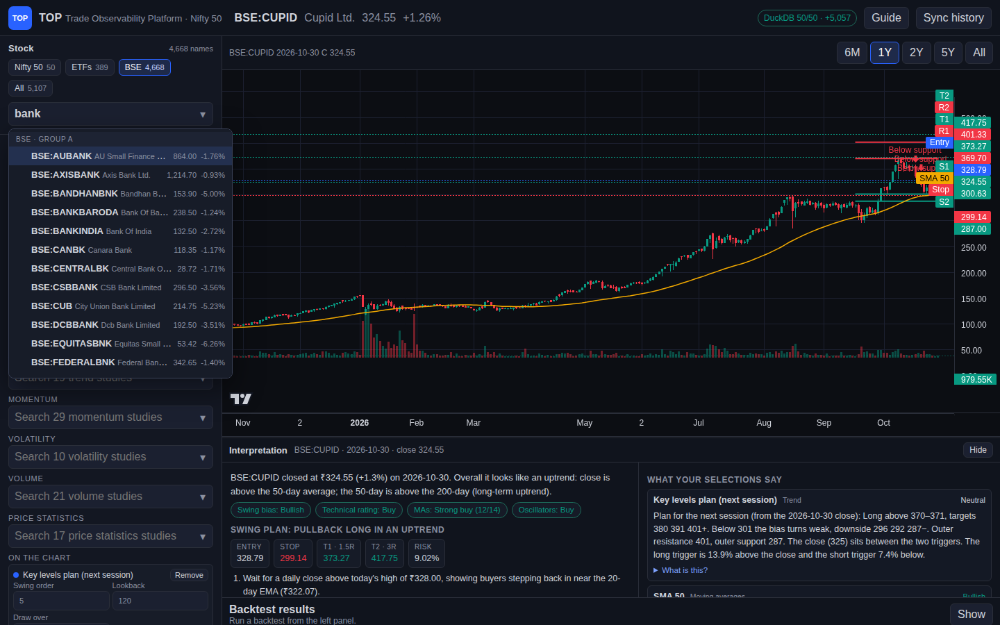
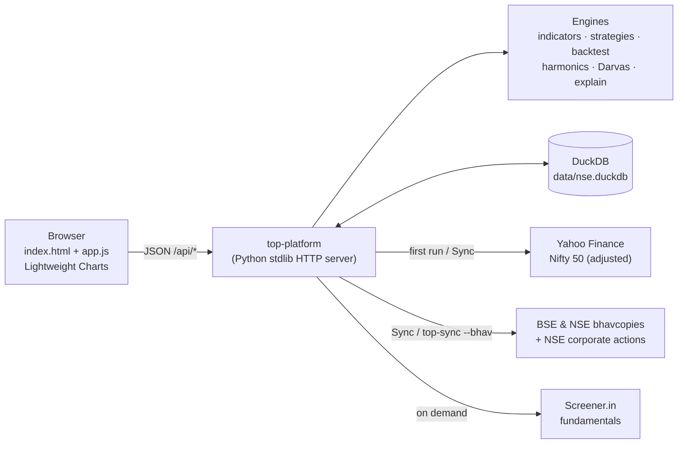

<div align="center">

# 📈 TOP — Trade Observability Platform

**A local, TradingView-style research desk for Indian markets: the Nifty 50, ~4,700 BSE stocks, and ~390 ETFs.**<br/>
Chart any of them, stack 148 indicators, spot Scott Carney harmonics and Darvas boxes,<br/>
backtest 88 strategies on one stock or a whole universe, and read a plain-English swing-trade plan, all on your own machine.

[](https://github.com/garv08/Trade-Observability-Platform/actions/workflows/ci.yml)


[](LICENSE)


[Quick start](#-quick-start) · [Screenshots](#-a-quick-tour) · [Features](#-features) · [Install guide](docs/installation.md) · [User guide](docs/user-guide.md) · [Docs](docs/README.md)


</div>

> [!IMPORTANT]
> **Research tool, not advice.** TOP uses delayed public daily data. It is not a live NSE feed, not a broker, and not affiliated with NSE, TradingView, Screener.in, Harmonic Trader, or the YouTube creators whose ideas it adapts. Backtests and historical odds describe the past, not the future.

---

## 🚀 Quick start

```bash
git clone https://github.com/garv08/Trade-Observability-Platform.git
cd Trade-Observability-Platform
python3 -m venv .venv && source .venv/bin/activate
pip install -e .
top-platform
```

Open **http://127.0.0.1:8000**. On the first run TOP downloads about five years of daily history for the Nifty 50 (1–2 minutes). The top bar shows `Nifty sync 12/50`, then `DuckDB 50/50`.

To add **all BSE stocks and NSE/BSE ETFs**, click **Sync history** in the app, or run `top-sync --bhav`. This downloads five years of exchange bhavcopies, about 1,300 files and 30–40 minutes the first time, then seconds per day after that.

> [!TIP]
> On Ubuntu/Debian you may first need `sudo apt install -y git python3-venv python3-pip`. Windows and macOS steps, `pipx`, upgrading, and troubleshooting are in the **[installation guide](docs/installation.md)**.

---

## 📸 A quick tour

<table>
<tr>
<td width="50%" valign="top">

### 1 · Chart, indicators, and the Interpretation pane
Pick any Nifty 50 stock from a searchable dropdown and stack studies from 10 sections. Here: SMA 20/50/200 (added with **+ Another**), Bollinger Bands with a grey fill, and the swing plan's Entry/Stop/T1/T2 on the price axis. The pane below explains every selection in plain English.

</td>
<td width="50%" valign="top">

### 2 · Scott Carney harmonics
Gartley, Bat, Alternate Bat, Butterfly, Crab, Deep Crab, Cypher, Shark, 5-0, AB=CD, and Three Drives, drawn as X-A-B-C-D legs with ratio guides. **Harmonics list** shows each pattern's date, side, PRZ, and measured ratios.

</td>
</tr>
<tr>
<td></td>
<td></td>
</tr>
<tr>
<td valign="top">

### 3 · Darvas boxes and breakout detection
Nicolas Darvas boxes (3-day top and bottom confirmation) and a volume-confirmed **Breakout & trend detector** that flags breakouts, breakdowns, failed breakouts, and the ATR trailing trend that follows.

</td>
<td valign="top">

### 4 · Backtests with full results
Signal at the close, fill at the next open, with costs. Results include return, CAGR, max drawdown, Sharpe, Sortino, win rate, profit factor, exposure, the equity curve against buy and hold, and every trade.

</td>
</tr>
<tr>
<td></td>
<td></td>
</tr>
<tr>
<td colspan="2" valign="top">

### 5 · Strategies from YouTube creators, and Backtest universe
Rules adapted from **@neurotrader888** and **@UnbiasedTradingGoshawk** sit in their own searchable groups, each with sources and a confidence label. **Backtest universe** runs any strategy on the Nifty 50, or on the most traded ETFs or BSE stocks, and ranks them.


</td>
</tr>
<tr>
<td width="50%" valign="top">

### 6 · Key levels and pattern breakouts
A method inspired by **@TradZoo**: nearby support and resistance shown as a long/short plan with stepped targets, plus wedge, triangle and channel breakouts with a measured target.

</td>
<td width="50%" valign="top">

### 7 · All BSE stocks and NSE/BSE ETFs
Universe chips switch between the Nifty 50, about 390 ETFs and about 4,700 BSE stocks. Five years of daily data come from bhavcopies and are adjusted for splits and bonuses.

</td>
</tr>
<tr>
<td></td>
<td></td>
</tr>
</table>

---

## ✨ Features

| | Feature | Details |
| --- | --- | --- |
| 🗂️ | **Nifty 50** | About five years of adjusted daily bars from Yahoo in a local DuckDB file. Includes `M&M`, `ETERNAL` (formerly Zomato), and `TMPV` |
| 🏛️ | **All BSE stocks and ETFs** | ~4,700 BSE equities, ~355 NSE ETFs, and ~35 BSE-only ETFs from the exchanges' daily bhavcopies, five years deep. Split and bonus adjusted from NSE corporate actions plus a price-gap rule. **Universe** chips switch between Nifty 50, ETFs, BSE, and All |
| 📊 | **TradingView-style chart** | TradingView Lightweight Charts with candles, volume, overlays, oscillator panes, and 6M/1Y/2Y/5Y/All ranges |
| 🧮 | **148 indicators** in 10 sections | Harmonics · @neurotrader888 · @UnbiasedTradingGoshawk · Moving averages · Bands and channels · Trend · Momentum · Volatility · Volume · Price statistics. [Full catalog →](docs/indicators.md) |
| ⏱️ | **Flexible durations** | Period presets (5 … 200), free entry, and **+ Another** to add SMA 20/50/200 side by side. Adjustable EMA-ribbon lengths |
| 🌫️ | **Shaded bands** | Every band or channel with upper and lower lines is shaded light grey, drawn under the candles |
| 🦋 | **Scott Carney harmonics** | 11 patterns plus "all", drawn as XABCD legs, on by default for every stock and backtestable |
| 📐 | **Key levels plan & pattern breakouts** | Next-session long and short triggers, three stepped targets, and outer support/resistance written up like a daily analysis post. Wedge, triangle, channel, and range breakouts with buying zone, stop, and a measured-move target. Method inspired by [@TradZoo](https://x.com/TradZoo)'s public chart posts |
| 📦 | **Darvas box & breakout detector** | Boxes, breakouts, breakdowns, failed breakouts, and ATR trailing trend, each with a strategy |
| 🧪 | **88 strategies** | Trend, breakout, trend reversal, harmonics, oscillators, mean reversion, price action, volume, and two creator groups. [Full catalog →](docs/strategies.md) |
| 🏁 | **Backtest universe** | Run one strategy on all 50 Nifty stocks, or on the 200 most traded names of the ETF, BSE, or combined universe, ranked by return |
| 🎥 | **YouTube creator strategies** | 13 rules adapted from @neurotrader888's MIT-licensed code and the public sources @UnbiasedTradingGoshawk tests. [Details →](docs/creators.md) |
| 🗣️ | **Interpretation pane** | Plain-English reading of every selected study and strategy, a technical rating (MA and oscillator votes), and a swing plan with trigger, entry, stop, T1/T2, position size, and historical odds on the same stock |
| 🔎 | **Trend scan** | Every trend, breakout, and reversal rule on the selected stock in one click |
| 🏢 | **Fundamentals** | Ratios and pros/cons from the public Screener.in page, cached for six hours |
| 🔗 | **Shareable links** | `/?symbol=INFY&studies=sma:50,sma:200,bbands&strategy=darvas_breakout&run=backtest` opens straight to a set-up |
| ✅ | **Verify** | In-app checks across front end, back end, and data, plus `python -m top.verify` and an offline test suite in CI |

---

## 🧭 How it works



- **One process, one dependency.** A standard-library HTTP server and `duckdb`. No NumPy, no Node build, no accounts, no API keys.
- **Everything is computed from your stored bars** when you ask, so the chart, backtests, and readings always agree.
- **No look-ahead.** Pivots, boxes, and breakouts appear only once they're confirmed. Trades fill at the next open.

Read the full [design document](docs/design.md) for the architecture, algorithms, and decisions.

---

## 📚 Documentation

| Guide | What's inside |
| --- | --- |
| 🛠️ [Installation](docs/installation.md) | Linux, macOS, Windows, `pipx`, upgrading, uninstalling, running in the background, troubleshooting |
| 🧑‍💻 [User guide](docs/user-guide.md) | A walkthrough of every panel and button, with screenshots and example links |
| 🧮 [Indicator catalog](docs/indicators.md) | All 148 studies with settings and ranges |
| 🧪 [Strategy catalog](docs/strategies.md) | All 88 strategies with rules and settings |
| 🎥 [Creator strategies](docs/creators.md) | @neurotrader888 and @UnbiasedTradingGoshawk: sources, confidence, adaptations, results |
| 🏗️ [Design](docs/design.md) | Architecture, data, algorithms, decisions, performance, security, testing |
| 🔌 [HTTP API](docs/api.md) | Every route with request and response examples |
| 🧰 [Development](docs/development.md) | Code layout, tests, adding an indicator or strategy, releases |
| 🤝 [Contributing](CONTRIBUTING.md) · 📝 [Changelog](CHANGELOG.md) · 🔐 [Security](SECURITY.md) | Project process |

The same user guide is built into the app: click **Guide** in the top bar.

---

## ⚙️ Configuration

| Setting | Flag | Environment variable | Default |
| --- | --- | --- | --- |
| Bind address | `--host` | `TOP_HOST` | `127.0.0.1` |
| Port | `--port` | `TOP_PORT` | `8000` |
| Database file | `top-sync --db` | `TOP_DB` | `./data/nse.duckdb` (relative to where you start TOP) |
| Download on first start | `--no-sync` turns it off | `TOP_AUTO_SYNC=0` turns it off | on |

```bash
TOP_DB=~/top-data/nse.duckdb top-platform --port 8050
```

> [!WARNING]
> TOP has no login. Keep it on `127.0.0.1` unless you put it behind your own access control.

---

## ❓ FAQ

<details>
<summary><b>Is this a live trading or brokerage app?</b></summary>

No. TOP reads delayed public **daily** bars and never places orders. It is for research, learning, and back-testing ideas.
</details>

<details>
<summary><b>Where does the data come from, and how fresh is it?</b></summary>

The Nifty 50 comes from Yahoo Finance's public chart endpoint, adjusted for splits and dividends. BSE stocks and ETFs come from the exchanges' official daily bhavcopy files. These are adjusted for splits and bonus issues, not dividends, using NSE corporate actions plus a price-gap rule for BSE-only stocks. Everything is stored in DuckDB. Click **Sync history** or run `top-sync` after the market closes to refresh. Fundamentals come from Screener.in on demand.
</details>

<details>
<summary><b>Why does it pin <code>duckdb==1.1.3</code> and avoid NumPy?</b></summary>

So it runs on older x86 CPUs without SSE4.2/POPCNT. Newer DuckDB and NumPy 2 builds crash there with "Illegal instruction". TOP includes its own small array helpers instead.
</details>

<details>
<summary><b>Are the swing plan's odds a prediction?</b></summary>

No. They replay the same rule on that stock's own history and report how often it worked. They describe the past, and results near 50% or 0R mean there was no edge.
</details>

<details>
<summary><b>Did you download YouTube videos to build the creator strategies?</b></summary>

No. Rules were re-implemented from public text: video descriptions and chapters, the creators' own open-source code, and the papers or books the videos test. Each strategy shows its sources and a confidence label. See [creators.md](docs/creators.md).
</details>

<details>
<summary><b>Can I add my own indicator or strategy?</b></summary>

Yes. Each is a small Python function registered in a catalog. See [Development → Add an indicator / strategy](docs/development.md).
</details>

---

## 🗺️ Roadmap

- [ ] Walk-forward and Monte-Carlo permutation tests in the UI
- [ ] Saved layouts and watchlists
- [ ] Alerts when a breakout, Darvas, or harmonic signal fires
- [ ] Optional NSE index and F&O data for short-side setups
- [ ] Desktop wrapper (single-click app)

Ideas and pull requests are welcome; see [CONTRIBUTING.md](CONTRIBUTING.md).

---

## 🙏 Credits

- [TradingView Lightweight Charts™](https://github.com/tradingview/lightweight-charts) (Apache-2.0) for the chart engine
- [DuckDB](https://duckdb.org) for local storage
- [neurotrader888](https://github.com/neurotrader888) and [Unbiased Trading](https://www.youtube.com/@UnbiasedTradingGoshawk) for the published ideas adapted in `top/creators.py`
- Scott M. Carney's harmonic ratios, Nicolas Darvas's box method, and Larry Connors' published rules

See [THIRD_PARTY_NOTICES.md](THIRD_PARTY_NOTICES.md).

## 📄 License

[MIT](LICENSE) © 2026 garv08 and TOP contributors. The bundled chart library keeps its Apache-2.0 license.
