<div align="center">

# 📈 TOP — Trade Observability Platform

**A local, TradingView-style research desk for Indian markets: every NSE main-board stock (~2,600 plus the Nifty 50), ~4,700 BSE stocks, ~390 ETFs, and ~250 NSE/BSE indices.**<br/>
Chart any of them, stack 152 indicators, spot Scott Carney harmonics and Darvas boxes,<br/>
backtest 92 strategies on one stock or a whole universe, rank every strategy on every script in a leaderboard (CSV in <a href="results/">results/</a>),<br/>run monthly top-N portfolio backtests, watch market breadth and regimes, and read a plain-English swing-trade plan, all on your own machine.

[](https://github.com/garv08/Trade-Observability-Platform/actions/workflows/ci.yml)


[](LICENSE)


[Quick start](#-quick-start) · [Screenshots](#-a-quick-tour) · [Leaderboard results](results/) · [Features](#-features) · [Install guide](docs/installation.md) · [User guide](docs/user-guide.md) · [Docs](docs/README.md)

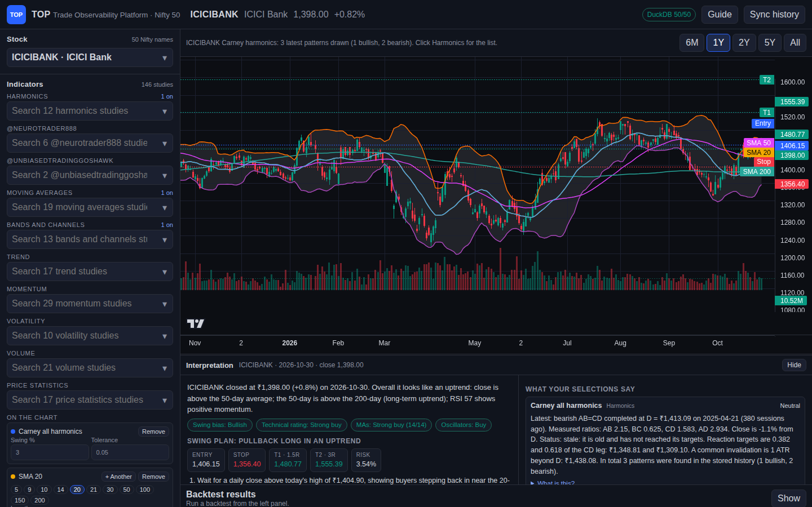

</div>

> [!IMPORTANT]
> **Research tool, not advice.** TOP uses delayed public daily data. It is not a live NSE feed, not a broker, and not affiliated with NSE, TradingView, Screener.in, Harmonic Trader, or the YouTube creators whose ideas it adapts. Backtests and historical odds describe the past, not the future.

---

## 🚀 Quick start

```bash
git clone https://github.com/garv08/Trade-Observability-Platform.git
cd Trade-Observability-Platform
python3 -m venv .venv && source .venv/bin/activate
pip install -e .
top-platform
```

Open **http://127.0.0.1:8000**. On the first run TOP downloads about five years of daily history for the Nifty 50 (1–2 minutes). The top bar shows `Nifty sync 12/50`, then `DuckDB 50/50`.

To add **all BSE stocks, NSE/BSE ETFs, NSE/BSE indices, and NSE delivery %**, click **Sync history** in the app, or run `top-sync --bhav`. This downloads five years of exchange bhavcopies, index files and delivery files, about 3,900 files and 1–2 hours the first time, then seconds per day after that.

Then open **Leaderboard** in the top bar and press **Run backtests** to rank all 92 strategies on every script by CAGR ÷ max drawdown (a few hours in the background on a slow PC; resumable).

> [!TIP]
> On Ubuntu/Debian you may first need `sudo apt install -y git python3-venv python3-pip`. Windows and macOS steps, `pipx`, upgrading, and troubleshooting are in the **[installation guide](docs/installation.md)**.

---

## 📸 A quick tour

<table>
<tr>
<td width="50%" valign="top">

### 1 · Chart, indicators, and the Interpretation pane
Pick any Nifty 50 stock from a searchable dropdown and stack studies from 10 sections. Here: SMA 20/50/200 (added with **+ Another**), Bollinger Bands with a grey fill, and the swing plan's Entry/Stop/T1/T2 on the price axis. The pane below explains every selection in plain English.

</td>
<td width="50%" valign="top">

### 2 · Scott Carney harmonics
Gartley, Bat, Alternate Bat, Butterfly, Crab, Deep Crab, Cypher, Shark, 5-0, AB=CD, and Three Drives, drawn as X-A-B-C-D legs with ratio guides. **Harmonics list** shows each pattern's date, side, PRZ, and measured ratios.

</td>
</tr>
<tr>
<td></td>
<td>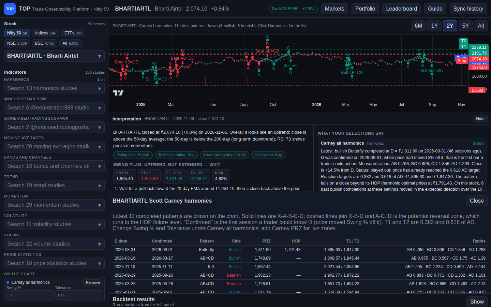</td>
</tr>
<tr>
<td valign="top">

### 3 · Darvas boxes and breakout detection
Nicolas Darvas boxes (3-day top and bottom confirmation) and a volume-confirmed **Breakout & trend detector** that flags breakouts, breakdowns, failed breakouts, and the ATR trailing trend that follows.

</td>
<td valign="top">

### 4 · Backtests with full results
Signal at the close, fill at the next open, with costs. Results include return, CAGR, max drawdown, Sharpe, Sortino, win rate, profit factor, exposure, the equity curve against buy and hold, and every trade.

</td>
</tr>
<tr>
<td>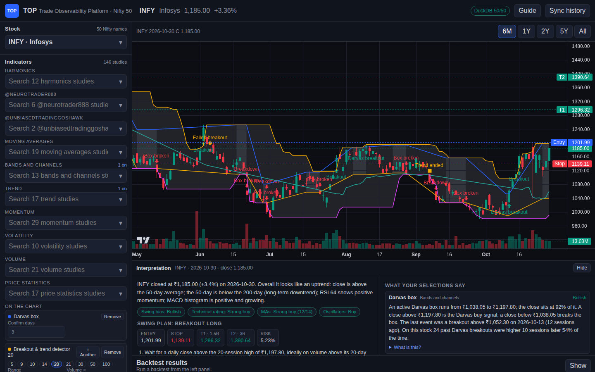</td>
<td>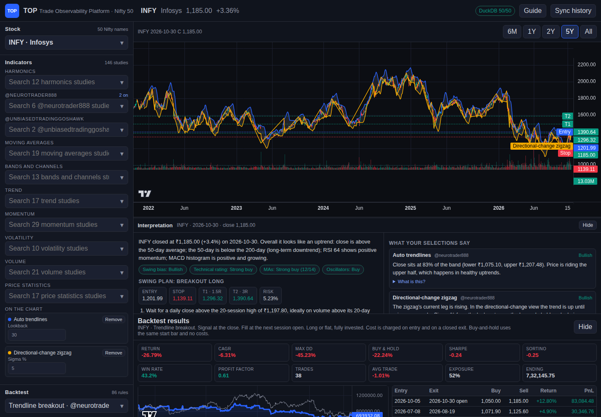</td>
</tr>
<tr>
<td colspan="2" valign="top">

### 5 · Strategies from YouTube creators, and Backtest universe
Rules adapted from **@neurotrader888** and **@UnbiasedTradingGoshawk** sit in their own searchable groups, each with sources and a confidence label. **Backtest universe** runs any strategy on the Nifty 50, or on the most traded ETFs or BSE stocks, and ranks them.

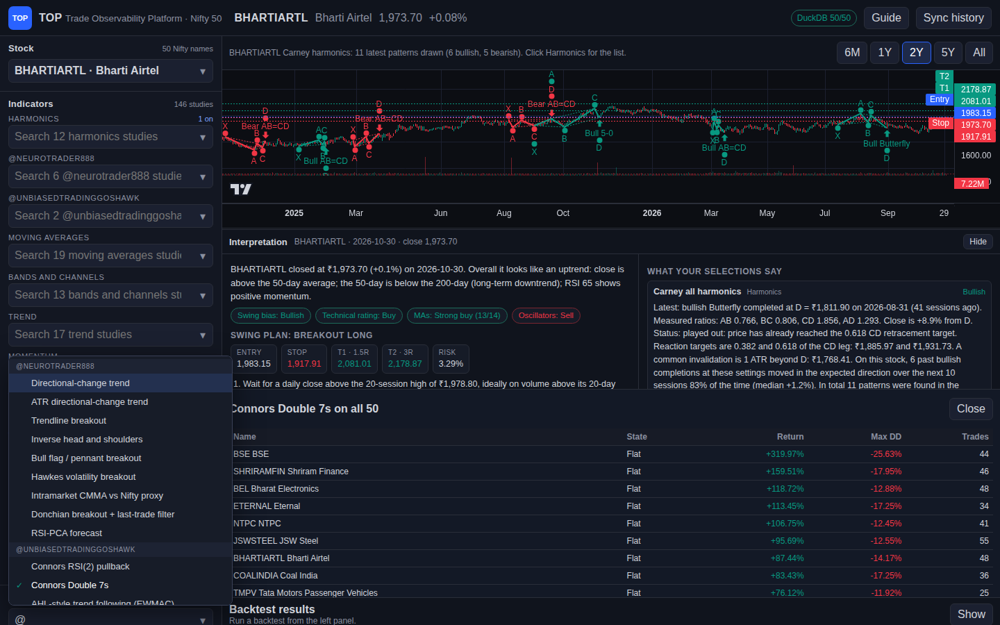

</td>
</tr>
<tr>
<td width="50%" valign="top">

### 6 · Key levels and pattern breakouts
A method inspired by **@TradZoo**: nearby support and resistance shown as a long/short plan with stepped targets, plus wedge, triangle and channel breakouts with a measured target.

</td>
<td width="50%" valign="top">

### 7 · All BSE stocks and NSE/BSE ETFs
Universe chips switch between the Nifty 50, about 2,600 more NSE stocks, about 390 ETFs and about 4,700 BSE stocks. Five years of daily data come from bhavcopies and are adjusted for splits and bonuses.

</td>
</tr>
<tr>
<td>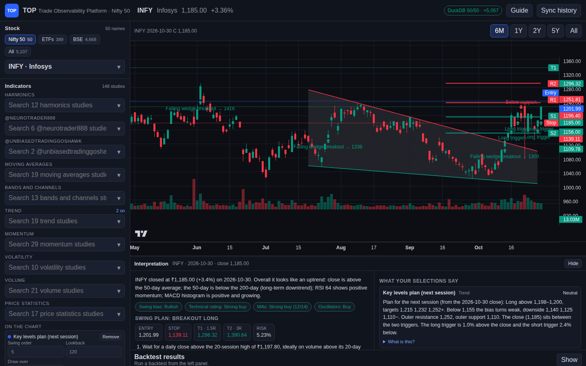</td>
<td></td>
</tr>
<tr>
<td colspan="2" valign="top">

### 8 · Strategy leaderboard: every strategy on every script
All 92 strategies backtested on every stock, ETF, and index (**416,382 backtests on 4,526 scripts**), ranked by **CAGR ÷ |max drawdown|**. The default view keeps CAGR above 15%, at least 3 trades, at least 2 tested years, and ₹10 lakh traded a day. Filter, sort, see which strategies pass most often, open any row on the chart, or download the CSV. Snapshots are in [`results/`](results/).

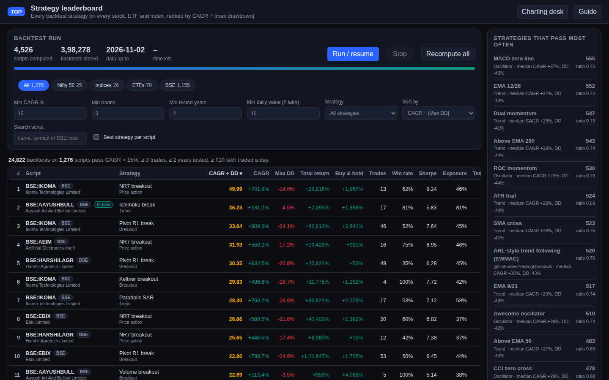

</td>
</tr>
<tr>
<td colspan="2" valign="top">

### 9 · Which strategy works best across stocks?
**By strategy** ranks the strategies themselves by **median total return ÷ max drawdown across all qualifying scripts**, with no CAGR cut so losers count. It also shows the middle half, % profitable, % beating buy-and-hold, and the best script. Donchian 55 leads, then **turn of the month** (new from the research digest, profitable on 83% of 1,734 scripts), Donchian 20, MACD zero line and EMA 12/26. A deflated-Sharpe column shows how few results survive a luck test. [Full table →](results/strategy-ranking-return-dd.csv) · reproduce with `top-leaderboard --results results`.

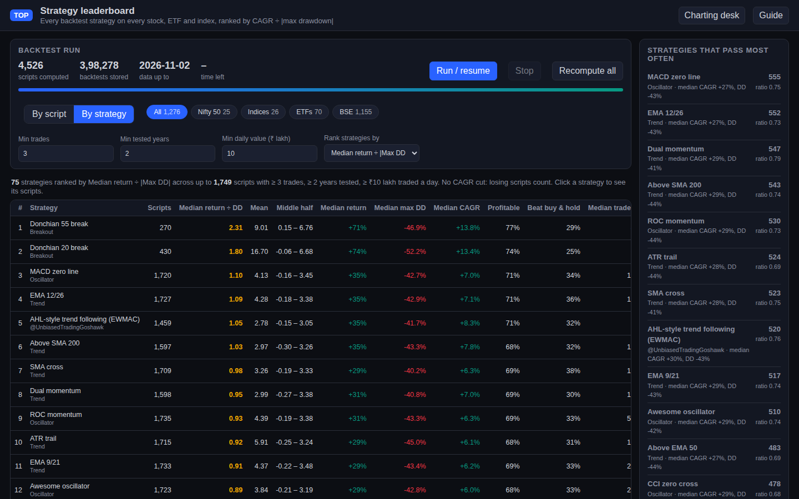

</td>
</tr>
<tr>
<td colspan="2" valign="top">

### 10 · Markets: breadth, volatility regime, sectors, scans
Nifty with its volatility regime shaded (calm, normal, stressed), % of stocks above their 50- and 200-day averages, new highs minus new lows, sector rotation against Nifty, FII/DII flows, and eight stock scans such as *Bloodbath* (30–60% off the high) and multi-year breakouts. Ideas from the [X research digest](docs/research/x-digest.md).

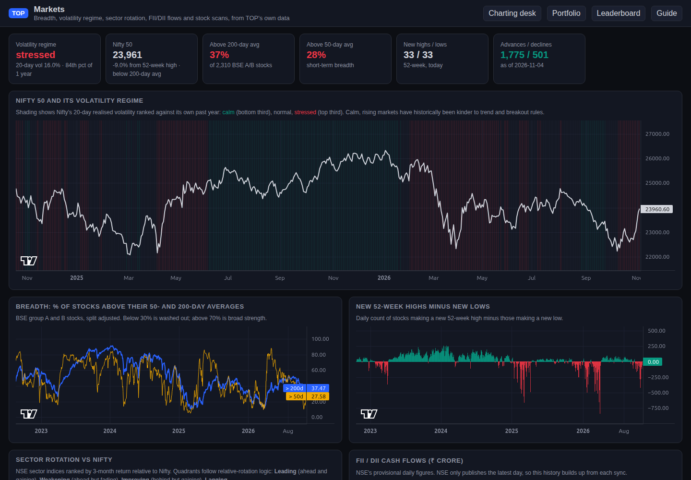

</td>
</tr>
<tr>
<td colspan="2" valign="top">

### 11 · Portfolio backtests: rank a universe, hold the top N
Momentum 12-1, low volatility, sector rotation and ETF momentum, rebalanced monthly at the next open with costs, against Nifty 50, with an underwater chart, current holdings and an N sweep.

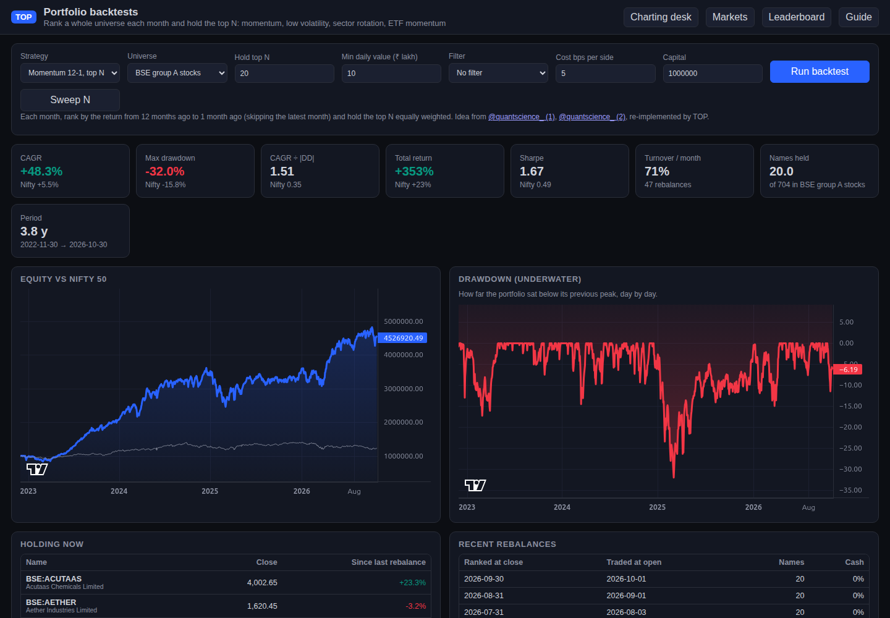

</td>
</tr>
</table>

---

## ✨ Features

| | Feature | Details |
| --- | --- | --- |
| 🗂️ | **Nifty 50** | About five years of adjusted daily bars from Yahoo in a local DuckDB file. Includes `M&M`, `ETERNAL` (formerly Zomato), and `TMPV` |
| 🏛️ | **All NSE and BSE stocks, and ETFs** | Every NSE main-board stock (EQ/BE/BZ series, ~2,600 plus the Nifty 50; SME/Emerge excluded), ~4,700 BSE equities, ~355 NSE ETFs, and ~35 BSE-only ETFs from the exchanges' daily bhavcopies, five years deep. NSE stocks keep their history through renames (matched by ISIN). Split and bonus adjusted from NSE corporate actions plus a price-gap rule. **Universe** chips switch between Nifty 50, Indices, ETFs, NSE, BSE, and All |
| 📊 | **TradingView-style chart** | TradingView Lightweight Charts with candles, volume, overlays, oscillator panes, and 6M/1Y/2Y/5Y/All ranges |
| 🧮 | **152 indicators** in 10 sections | Harmonics · @neurotrader888 · @UnbiasedTradingGoshawk · Moving averages · Bands and channels · Trend · Momentum · Volatility · Volume · Price statistics. [Full catalog →](docs/indicators.md) |
| ⏱️ | **Flexible durations** | Period presets (5 … 200), free entry, and **+ Another** to add SMA 20/50/200 side by side. Adjustable EMA-ribbon lengths |
| 🌫️ | **Shaded bands** | Every band or channel with upper and lower lines is shaded light grey, drawn under the candles |
| 🦋 | **Scott Carney harmonics** | 11 patterns plus "all", drawn as XABCD legs, on by default for every stock and backtestable |
| 📐 | **Key levels plan & pattern breakouts** | Next-session long and short triggers, three stepped targets, and outer support/resistance written up like a daily analysis post. Wedge, triangle, channel, and range breakouts with buying zone, stop, and a measured-move target. Method inspired by [@TradZoo](https://x.com/TradZoo)'s public chart posts |
| 📦 | **Darvas box & breakout detector** | Boxes, breakouts, breakdowns, failed breakouts, and ATR trailing trend, each with a strategy |
| 🧪 | **92 strategies** | Trend, breakout, trend reversal, harmonics, oscillators, mean reversion, price action, volume, and two creator groups. [Full catalog →](docs/strategies.md) |
| 📈 | **NSE and BSE indices** | ~170 NSE indices (Nifty 50, Bank, sectoral, thematic, strategy, India VIX) for five years, and ~80 BSE indices (Sensex, BSE 100/500, sectoral) from April 2025, from the exchanges' daily index files. An **Indices** chip lists them |
| 🏆 | **Strategy leaderboard** | A separate page that backtests all 92 strategies on every script and index (~450,000 backtests, resumable background job on all CPU cores) and ranks them by **CAGR ÷ \|max drawdown\|** (drawdown floored at 5%). Default view: CAGR above 15%, ≥ 3 trades, ≥ 2 tested years, ≥ ₹10 lakh traded a day. Filter by universe, strategy, and script; best strategy per script; a **By strategy** view ranking strategies by median total return ÷ max drawdown across scripts; full CSV export; click a row to open it on the chart. `top-leaderboard --results results` rebuilds the committed CSVs on any machine. A data-quality gate skips thin or glitchy series |
| 📊 | **Markets page** | Nifty volatility regime (20-day volatility vs its past year: calm, normal, stressed) shaded on the chart; breadth over ~2,300 BSE A/B stocks (% above 50/200-day averages, new highs − new lows, advances/declines); sector rotation with relative-rotation quadrants; FII/DII cash flows; eight scans: Bloodbath, multi-year breakout, 52-week breakout, breakout soon, leaders while Nifty falls, 1-year multibaggers, near 52-week low, delivery surge |
| 💼 | **Portfolio backtests** | Rank a universe each month and hold the top N: momentum 12-1, low volatility, sector rotation, ETF momentum with a trend filter. Next-open trades, costs, Nifty benchmark, underwater chart, holdings, N sweep, optional market filter |
| 🔬 | **Robustness tools** | Monte Carlo trade reshuffling (range of drawdowns), walk-forward re-tuning (is the setting over-fitted?), probabilistic and **deflated Sharpe** on the leaderboard (is the result luck among 92 tries?), Kelly fraction in every backtest |
| ⚖️ | **Position sizing** | Backtests can size each entry to a volatility target or half Kelly instead of all-in |
| 🧪 | **Quant research strategies** | TSMOM 12-month, Kalman trend, turn of the month, Hurst regime router, plus Kalman level, Hurst, Delivery % and Market regime studies, from the [X research digest](docs/research/x-digest.md) |
| 📦 | **Delivery % and FII/DII** | Five years of NSE delivery % for ~2,800 NSE-traded names, and a daily FII/DII cash snapshot |
| 🏁 | **Backtest universe** | Run one strategy on all 50 Nifty stocks, or on all indices, or on the 200 most traded names of the ETF, BSE, or combined universe, ranked by return |
| 🎥 | **YouTube creator strategies** | 13 rules adapted from @neurotrader888's MIT-licensed code and the public sources @UnbiasedTradingGoshawk tests. [Details →](docs/creators.md) |
| 🗣️ | **Interpretation pane** | Plain-English reading of every selected study and strategy, a technical rating (MA and oscillator votes), and a swing plan with trigger, entry, stop, T1/T2, position size, and historical odds on the same stock |
| 🔎 | **Trend scan** | Every trend, breakout, and reversal rule on the selected stock in one click |
| 🏢 | **Fundamentals** | Ratios and pros/cons from the public Screener.in page, cached for six hours |
| 🔗 | **Shareable links** | `/?symbol=INFY&studies=sma:50,sma:200,bbands&strategy=darvas_breakout&run=backtest` opens straight to a set-up |
| ✅ | **Verify** | In-app checks across front end, back end, and data, plus `python -m top.verify` and an offline test suite in CI |

---

## 🧭 How it works

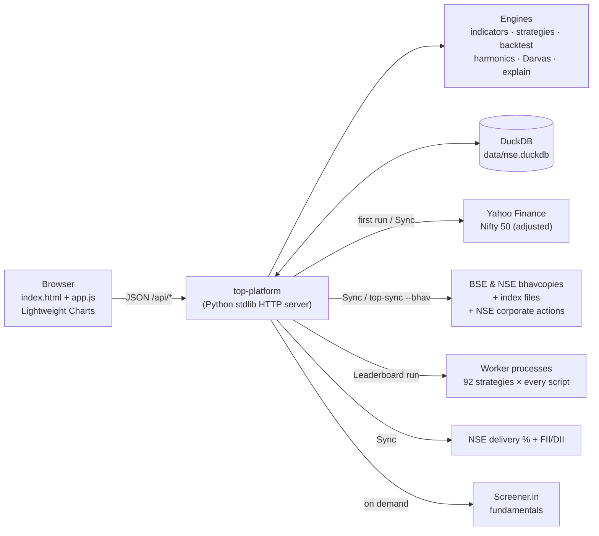

- **One process, one dependency.** A standard-library HTTP server and `duckdb`. No NumPy, no Node build, no accounts, no API keys.
- **Everything is computed from your stored bars** when you ask, so the chart, backtests, and readings always agree.
- **No look-ahead.** Pivots, boxes, and breakouts appear only once they're confirmed. Trades fill at the next open.

Read the full [design document](docs/design.md) for the architecture, algorithms, and decisions.

---

## 📚 Documentation

| Guide | What's inside |
| --- | --- |
| 🛠️ [Installation](docs/installation.md) | Linux, macOS, Windows, `pipx`, upgrading, uninstalling, running in the background, troubleshooting |
| 🧑‍💻 [User guide](docs/user-guide.md) | A walkthrough of every panel and button, with screenshots and example links |
| 🧮 [Indicator catalog](docs/indicators.md) | All 152 studies with settings and ranges |
| 🧪 [Strategy catalog](docs/strategies.md) | All 92 strategies with rules and settings |
| 🎥 [Creator strategies](docs/creators.md) | @neurotrader888 and @UnbiasedTradingGoshawk: sources, confidence, adaptations, results |
| 🏗️ [Design](docs/design.md) | Architecture, data, algorithms, decisions, performance, security, testing |
| 🧭 [Research digest](docs/research/x-digest.md) | What TOP took from 13 X accounts, in our own words, and where each idea lives |
| 🏆 [Leaderboard results](results/) | CSV snapshots of every strategy on every script, with the filters used and how to refresh them |
| 🔌 [HTTP API](docs/api.md) | Every route with request and response examples |
| 🧰 [Development](docs/development.md) | Code layout, tests, adding an indicator or strategy, releases |
| 🤝 [Contributing](CONTRIBUTING.md) · 📝 [Changelog](CHANGELOG.md) · 🔐 [Security](SECURITY.md) | Project process |

The same user guide is built into the app: click **Guide** in the top bar.

---

## ⚙️ Configuration

| Setting | Flag | Environment variable | Default |
| --- | --- | --- | --- |
| Bind address | `--host` | `TOP_HOST` | `127.0.0.1` |
| Port | `--port` | `TOP_PORT` | `8000` |
| Database file | `top-sync --db` | `TOP_DB` | `./data/nse.duckdb` (relative to where you start TOP) |
| Download on first start | `--no-sync` turns it off | `TOP_AUTO_SYNC=0` turns it off | on |
| DuckDB memory cap | | `TOP_DB_MEMORY` | `768MB` (keeps small laptops responsive during long leaderboard runs) |
| Leaderboard worker processes | `top-leaderboard --workers` | `TOP_WORKERS` | up to 2 (set 1 on laptops with little free memory) |

```bash
TOP_DB=~/top-data/nse.duckdb top-platform --port 8050
```

> [!WARNING]
> TOP has no login. Keep it on `127.0.0.1` unless you put it behind your own access control.

---

## ❓ FAQ

<details>
<summary><b>Is this a live trading or brokerage app?</b></summary>

No. TOP reads delayed public **daily** bars and never places orders. It is for research, learning, and back-testing ideas.
</details>

<details>
<summary><b>Where does the data come from, and how fresh is it?</b></summary>

The Nifty 50 comes from Yahoo Finance's public chart endpoint, adjusted for splits and dividends. BSE stocks and ETFs come from the exchanges' official daily bhavcopy files. These are adjusted for splits and bonus issues, not dividends, using NSE corporate actions plus a price-gap rule for BSE-only stocks. Everything is stored in DuckDB. Click **Sync history** or run `top-sync` after the market closes to refresh. Fundamentals come from Screener.in on demand.
</details>

<details>
<summary><b>Why does it pin <code>duckdb==1.1.3</code> and avoid NumPy?</b></summary>

So it runs on older x86 CPUs without SSE4.2/POPCNT. Newer DuckDB and NumPy 2 builds crash there with "Illegal instruction". TOP includes its own small array helpers instead.
</details>

<details>
<summary><b>Are the swing plan's odds a prediction?</b></summary>

No. They replay the same rule on that stock's own history and report how often it worked. They describe the past, and results near 50% or 0R mean there was no edge.
</details>

<details>
<summary><b>Did you download YouTube videos to build the creator strategies?</b></summary>

No. Rules were re-implemented from public text: video descriptions and chapters, the creators' own open-source code, and the papers or books the videos test. Each strategy shows its sources and a confidence label. See [creators.md](docs/creators.md).
</details>

<details>
<summary><b>Can I add my own indicator or strategy?</b></summary>

Yes. Each is a small Python function registered in a catalog. See [Development → Add an indicator / strategy](docs/development.md).
</details>

---

## 🗺️ Roadmap

- [ ] Walk-forward and Monte-Carlo permutation tests in the UI
- [ ] Saved layouts and watchlists
- [ ] Alerts when a breakout, Darvas, or harmonic signal fires
- [ ] Optional NSE index and F&O data for short-side setups
- [ ] Desktop wrapper (single-click app)

Ideas and pull requests are welcome; see [CONTRIBUTING.md](CONTRIBUTING.md).

---

## 🙏 Credits

- [TradingView Lightweight Charts™](https://github.com/tradingview/lightweight-charts) (Apache-2.0) for the chart engine
- [DuckDB](https://duckdb.org) for local storage
- [neurotrader888](https://github.com/neurotrader888) and [Unbiased Trading](https://www.youtube.com/@UnbiasedTradingGoshawk) for the published ideas adapted in `top/creators.py`
- Scott M. Carney's harmonic ratios, Nicolas Darvas's box method, and Larry Connors' published rules

See [THIRD_PARTY_NOTICES.md](THIRD_PARTY_NOTICES.md).

## 📄 License

[MIT](LICENSE) © 2026 garv08 and TOP contributors. The bundled chart library keeps its Apache-2.0 license.
