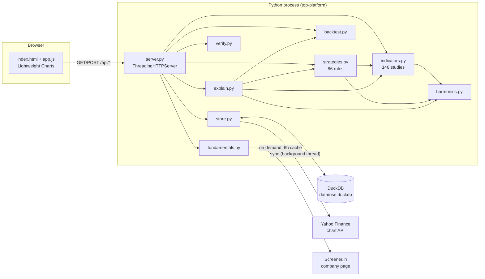
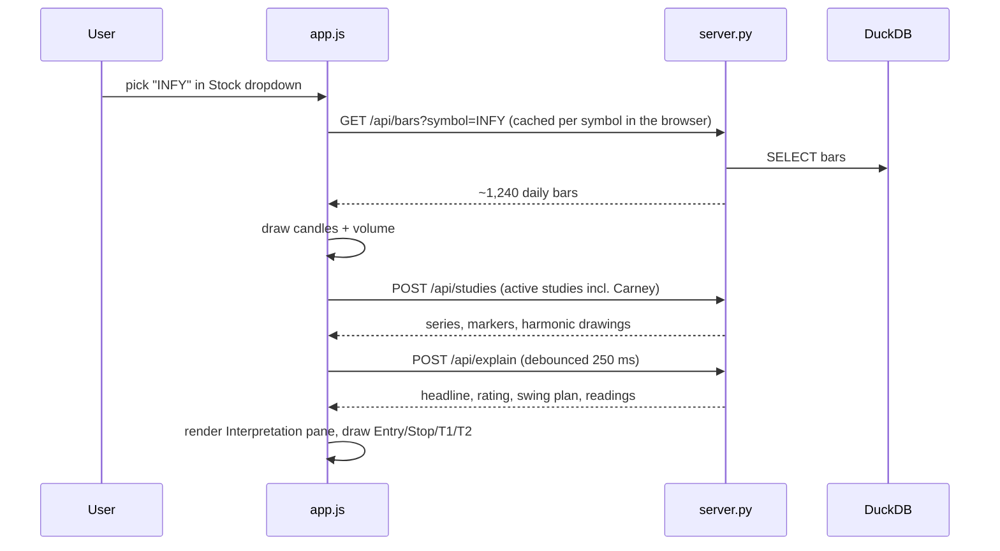
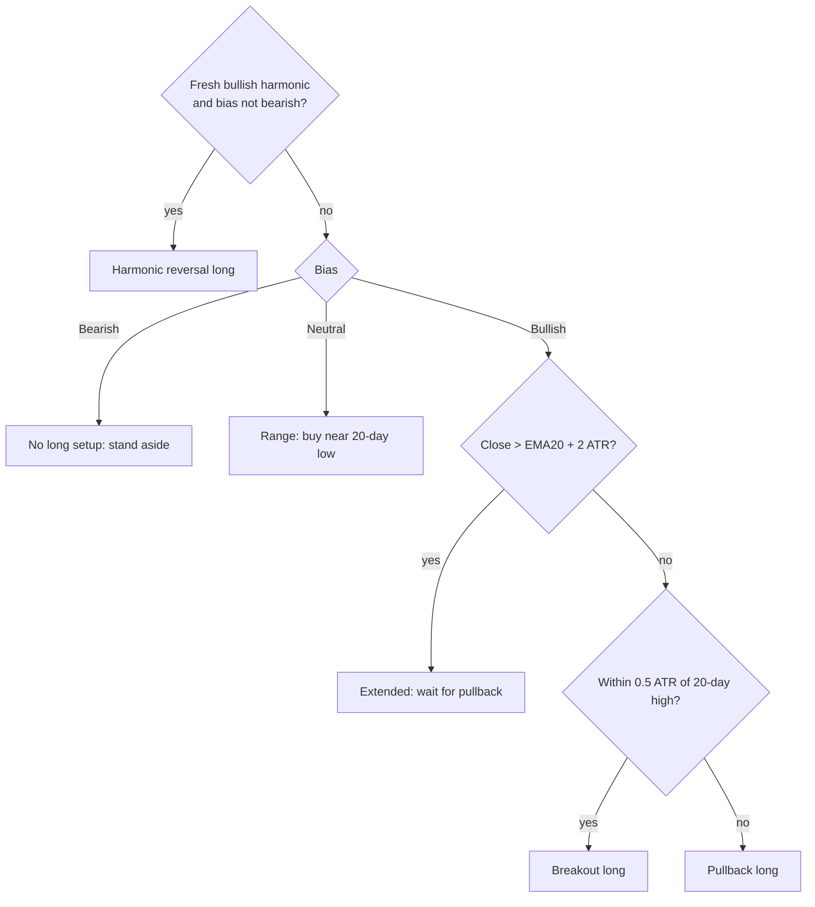

# TOP design document

| | |
| --- | --- |
| Product | TOP — Trade Observability Platform |
| Version | 0.1.0 |
| Status | Working local release |
| Scope | Nifty 50, daily bars, research and backtesting. No order routing |

## 1. Goals

1. **All 50 Nifty stocks in one local database**, filled automatically and fast to read.
2. **A TradingView-like chart** that switches stocks instantly and stacks studies on price or in panes.
3. **Breadth of analysis**: 100+ indicators in sections, Scott Carney harmonics, ~50+ strategies, all backtestable in the browser.
4. **Explain, don't just plot**: every selection gets a plain-English reading, plus a rule-based swing plan with honest historical odds.
5. **Verifiable**: named self-checks in the app and offline tests that start the real server.
6. **Easy to install**: one Python dependency, no build step, no accounts.

### Non-goals

- Live or intraday data, order placement, or portfolio accounting.
- Shorting in backtests. NSE cash-market shorts are intraday only, so strategies are long/flat.
- Certified pattern detection. The harmonics are ratio approximations of Carney's published rules.
- Multi-user hosting. There is no authentication; the server binds to `127.0.0.1` by default.

## 2. Architecture



- **One process.** The standard-library `ThreadingHTTPServer` serves the static web app from `top/web/` and a JSON API under `/api/`.
- **No front-end build.** `app.js` is plain JavaScript. The chart library is vendored, so the app works offline after the first data sync.
- **Computation happens on request.** Studies, strategies, and readings are computed from stored bars for each request. Nothing is precomputed except the bars themselves.

### Request flow: picking a stock



Each load carries a request token. A slow response for a previous stock is dropped instead of overwriting the current one. This fixed the earlier "Failed to fetch" race on fast clicks.

## 3. Modules

| Module | Responsibility | Notes |
| --- | --- | --- |
| `universe.py` | The 50 symbols, names, sectors, index weights, Yahoo tickers | `M&M` → `M&M.NS`; `ETERNAL`, `TMPV` use current tickers |
| `store.py` | DuckDB schema, `session()` lock, Yahoo download with retries, `replace_bars`, coverage, `top-sync` CLI | See §5 |
| `arrays.py` | Minimal NumPy-like `Array` (elementwise math, masks, `where`, `roll`, `nanmean`, …) | Lets TOP run on CPUs where NumPy 2 wheels crash |
| `indicators.py` | Indicator math and the study catalog (`id`, `section`, `pane`, `params`, `outputs`) | `compute()` returns series, plus optional markers and drawings |
| `strategies.py` | Strategy catalog and `signal()` → position array (1 long, 0 flat, NaN warm-up) | Reuses indicator math |
| `backtest.py` | Next-open fills, costs, equity, benchmark, trades, metrics | See §6.1 |
| `harmonics.py` | Zigzag pivots, Carney ratio matcher, study output, strategy positions | See §6.2 |
| `explain.py` | Per-study readings, technical rating, swing plan, historical odds | See §6.3 |
| `creators.py` | Strategies and studies adapted from @neurotrader888 and @UnbiasedTradingGoshawk, with sources and confidence | See [creators.md](creators.md) |
| `patterns.py` | Darvas boxes and the volume breakout / trend detector (studies with markers, plus strategies) | Causal: levels appear only once confirmed |
| `market.py` | Equal-weight Nifty 50 proxy from the stored bars, cached by store state | Used by the CMMA and contrarian rules |
| `fundamentals.py` | Screener.in fetch, `#top-ratios` and pros/cons parser, 6-hour cache | Standard-library HTML parser |
| `verify.py` | Named checks over catalogs, synthetic pattern, parser, data coverage, every study and strategy, interpretation | In-process, so `/api/verify` never calls itself over HTTP |
| `server.py` | Routing, input validation, JSON encoding, static files, CLI | `build_server()` is used by tests |
| `web/app.js` | Chart, searchable dropdowns, studies, harmonics drawing, tester, insight panel, interpretation pane | No framework |

## 4. User interface

```text
┌ top bar: TOP · selected stock · DuckDB 50/50 · Guide · Sync history ───────────────┐
│ Left panel (320px)           │ Chart toolbar: legend · 6M 1Y 2Y 5Y All               │
│  Stock ▾ (search)            │ Price chart (+ oscillator panes)                      │
│  Indicators                  │                                                       │
│   Harmonics ▾  Trend ▾ …     ├───────────────────────────────────────────────────────┤
│   On the chart (params)      │ Interpretation: swing outlook │ what selections say   │
│  Backtest                    ├───────────────────────────────────────────────────────┤
│   Strategy ▾ params capital  │ Output panel (Trend scan, Backtest 50, Fundamentals…) │
│   Run backtest · Backtest 50 ├───────────────────────────────────────────────────────┤
│  Analysis buttons            │ Backtest results (collapsed until first run)          │
└──────────────────────────────┴───────────────────────────────────────────────────────┘
```

- **Searchable dropdowns** replace long lists. Typed words must all match name, id, group, or sector. Arrow keys, Enter, and Esc work. Indicator dropdowns are multi-select and stay open.
- **Band shading** uses a Lightweight Charts series primitive (`BandFill` in `app.js`) attached to the candle series with `zOrder: "bottom"`, so the grey fill sits beneath the candles. Any price study with `upper` and `lower` outputs gets it.
- **Study copies.** Each active study is an instance with its own id, so the same study can be on the chart several times with different periods. Only the newest study request draws; older responses from quick clicks are dropped.
- **Shareable links.** On load, `openFromLink()` in `app.js` reads URL parameters (`symbol`, `studies`, `carney`, `strategy`, `range`, `run`, `menu`, `q`) to restore a set-up. The README screenshots use the same mechanism.
- **Nothing overlays the chart.** Scan output and readings live in panels below it, and the chart shrinks to fit.
- Under 1000px wide, the left panel becomes a drawer (**Controls**).

## 5. Data and storage

### Schema

```sql
symbols(symbol PK, name, sector, weight, rank, yahoo)
bars(symbol, interval, ts DATE, open, high, low, close, volume, PRIMARY KEY(symbol, interval, ts))
meta(key PK, value)          -- last_sync
```

### Sync

- Source: `query1.finance.yahoo.com/v8/finance/chart/{SYMBOL}.NS?interval=1d&range=5y`, with adjusted close.
- OHLC are scaled by `adjclose / close`, so splits and dividends do not create false gaps.
- Each symbol is retried 5 times with back-off. A failure is recorded and the sync moves on to the next symbol.
- Runs in a background thread on first start or on **Sync history**. `top-sync` runs it in the foreground.

### Concurrency and write path

- DuckDB connections are serialized by a process-wide lock (`session()`). The lock is never held during network calls.
- `replace_bars` deletes the symbol's rows, then `COPY`s a CSV into a temp table and inserts from it. Row-by-row inserts took about 18 s per symbol on the reference machine; `COPY` takes well under a second. DuckDB 1.1 also rejects deleting and re-inserting the same primary key with parameterised inserts in one transaction, which this path avoids.
- `ensure_schema` upserts symbols and is cached per process.

## 6. Algorithms

### 6.1 Backtest

- **Signal at the close, fill at the next session's open.** No look-ahead.
- Long or flat, fully invested when long, fractional shares.
- Cost in basis points on entry and on each closed exit (default 5 bps).
- Benchmark: buy and hold from the same first tradable bar, without costs.
- Metrics: total return, CAGR, max drawdown, Sharpe, Sortino, win rate, profit factor, trades, average trade, exposure, ending equity.

### 6.2 Scott Carney harmonics

1. **Zigzag.** A pivot is confirmed when price reverses by at least *Swing %* (default 3%) from the running extreme.
2. **XABCD windows.** Every five consecutive alternating pivots are tested, both bullish (X low) and bearish (X high, mirrored).
3. **Ratios.** AB/XA, BC/AB, CD/BC, AD/XA, XC/XA, and for Cypher CD/XC. Each is matched against the pattern's ranges within *Tolerance* (default ±0.05).

| Pattern | Key rules |
| --- | --- |
| Gartley | AB 0.618, BC 0.382–0.886, CD 1.272–1.618, AD 0.786 |
| Bat | AB 0.382–0.50, BC 0.382–0.886, CD 1.618–2.618, AD 0.886 |
| Alternate Bat | AB 0.382, CD 2.0–3.618, AD 1.13 |
| Butterfly | AB 0.786, CD 1.618–2.618, AD 1.272 |
| Crab | AB 0.382–0.618, CD 2.24–3.618, AD 1.618 |
| Deep Crab | AB 0.886, CD 2.0–3.618, AD 1.618 |
| Cypher | AB 0.382–0.618, XC 1.272–1.414, D 0.786 of XC |
| Shark | AB 1.13–1.618, BC 1.618–2.24, AD 0.886–1.13 |
| 5-0 | AB 1.13–1.618, BC 1.618–2.24, CD 0.50 |
| AB=CD | CD ≈ AB, BC 0.382–0.886 |
| Three Drives | Six pivots; retracements 0.618–0.786, extensions 1.272–1.618 |

4. **Output.** Each completion produces a marker at D. The latest 12 patterns are also drawn as X-A-B-C-D legs, with dashed X-B-D and A-C guides.
5. **Strategy.** A bullish completion is long for *Hold bars* (default 10), filled at the next open.

Pivots are confirmed only after the reversal threshold is crossed. D is therefore known a few bars after it prints, and the strategy enters on the completion bar as detected in hindsight. This makes harmonic backtests optimistic; the user guide states this limit.

### 6.3 Interpretation and swing plan (`explain.py`)

**Per-study readings.** Each study belongs to a family, and each family has a reader:

| Family | Reading |
| --- | --- |
| Moving average | Distance from close (%, ATR), 5-session slope, uptrend/pullback/downtrend wording |
| Band/channel | Position in band (%), squeeze from one-year width percentile |
| Trailing stop | Above/below, distance in ATR, used as an exit level |
| Bounded oscillator | Zone (e.g. RSI 30/70), direction, signal cross, one-year percentile |
| Zero-line oscillator | Sign, zero or signal crosses, momentum building or fading (MACD has its own wording) |
| Volatility | One-year percentile: compression or expansion, plus ATR in rupees |
| Cumulative volume | 20-session direction against price: confirmation or divergence |
| Money flow / volume | Accumulation or distribution; volume against its 20-day average |
| Trend tools | ADX/DI, Aroon, Vortex, Choppiness, Mass, Ichimoku cloud, EMA ribbon stack, pivots |
| Harmonics | Latest pattern, ratios, status (fresh, working, played out, failed, stale), 0.382 and 0.618 CD targets, invalidation 1 ATR beyond D, and this stock's past hit rate |

**Technical rating.** A vote in the style of TradingView's public technical-ratings method. Moving averages (SMA and EMA 10/20/30/50/100/200, Ichimoku base, HMA 9) vote buy when price is above. Oscillators (RSI, Stochastic, CCI, ADX/DI, Awesome, Momentum, MACD, Williams %R, Ultimate) vote buy, sell, or neutral by their usual rules. The scores average to Strong sell … Strong buy.

**Bias score.** Points for close vs SMA 50, SMA 50 vs SMA 200, RSI ≥55 or ≤45, MACD histogram sign and direction, the technical rating, and a fresh harmonic. A score ≥ 2 is Bullish and ≤ −2 is Bearish.

**Setup selection.**



Every long plan has an entry, a stop, T1 ≈ 1.5R and T2 ≈ 3R (or pattern targets), a 1%-risk position size, and a 10–15 session time stop.

**Historical odds.** The same plan is replayed on every past bar of that stock where the trend state matched. Pullback and breakout plans also require RSI within ±8; every plan also requires its own setup condition. Each replay enters at the close, uses the same stop in ATR multiples and the same target in R, and looks up to 15 sessions ahead. A bar that touches both stop and target counts as a loss. Replays are spaced at least five bars apart. The pane reports the count, hit rate, and average R. A **base rate** adds the 10-session forward-return distribution after sessions in the same trend state with RSI within ±5.

These are descriptive statistics about one stock's own past. They are not out-of-sample forecasts and do not account for regime change.

### 6.4 Fundamentals

`GET https://www.screener.in/company/{SYMBOL}/consolidated/`, with a polite user agent and a 6-hour in-memory cache. The parser reads `#top-ratios` name/value pairs and the `.pros` and `.cons` lists. No login or scraping beyond the public page.

## 7. Key decisions

| Decision | Why | Trade-off |
| --- | --- | --- |
| DuckDB file, not a server database | Zero setup, fast columnar reads, single file | One writer at a time, so writes are serialized |
| Pin `duckdb==1.1.3` | Newer builds and NumPy 2 crash with `Illegal instruction` on CPUs without SSE4.2/POPCNT (the reference machine) | Misses newer DuckDB features; no Python 3.14 wheels |
| Own `arrays.py` instead of NumPy | Same reason; keeps the dependency list to one package | Slower than NumPy, but fine for ~1,250 bars per stock |
| Standard-library HTTP server | No framework to install; easy to test with `build_server()` | No HTTP/2, no auth, single host |
| Vendored Lightweight Charts | Looks and feels like TradingView; Apache-2.0; no CDN needed | Library upgrades are manual |
| Compute on request | Always consistent with stored bars; no cache invalidation | Backtest 50 takes a few seconds |
| Long/flat only | Matches NSE cash-market delivery rules | No short strategies |
| REA not used to clone TradingView | Reverse engineering a commercial product was out of scope and unnecessary given an open-source chart library | — |

## 8. Performance (reference machine, older x86 laptop)

| Operation | Time |
| --- | --- |
| `/api/bars` for one stock | ~70 ms |
| All 146 studies on one stock | ~6 s total |
| Backtest 50 for a creator strategy | 4–13 s (RSI-PCA ~35 s) |
| `/api/explain` with a few studies | ~0.6 s |
| Backtest 50 (one harmonic strategy) | ~6 s |
| Full `python -m top.verify` | ~15 s |
| First full sync (network bound) | 1–2 min |

## 9. Security

- Binds `127.0.0.1` by default. There is no authentication, so do not expose it publicly without a proxy that adds access control.
- Static file serving resolves paths and refuses anything outside `top/web/`; this is covered by tests.
- Symbol and strategy inputs are checked against the catalogs before any computation or database access. Bar queries are parameterized.
- Outbound calls go only to Yahoo Finance and Screener.in.
- Front-end text from the server and from Screener.in is HTML-escaped before rendering.

## 10. Testing and verification

| Layer | What runs | Where |
| --- | --- | --- |
| Unit | Catalog sizes; every study has a latest value; EMA seeding regression; every strategy backtests; next-open fill; synthetic Gartley; harmonic drawings ordered; parser; rating labels; readings for every family; swing plan for all 50 | `tests/test_engine.py` |
| Integration | Real server on a free port: static files, path traversal, health, status, symbols, `M&M` bars, catalogs, studies with drawings, backtest, trend, scan, explain, verify | `tests/test_api.py` |
| Self-check | Named hooks on live data | **Verify** button, `/api/verify`, `python -m top.verify` |
| CI | Python 3.10–3.13 tests; wheel contents check; installed-wheel server smoke test | `.github/workflows/ci.yml` |

The tests are offline. They seed a temporary DuckDB with deterministic synthetic bars for all 50 names.

## 11. Known limits and future work

- Daily bars only. Intraday data would need a different source and storage layout.
- Harmonic detection confirms pivots in hindsight (see §6.2), so harmonic backtests are optimistic.
- No slippage model, taxes, or position-sizing variants in backtests.
- Screener.in layout changes would break the parser; the parser test and Verify will flag it.
- Possible next steps: walk-forward testing, saved layouts, alerts, F&O data for short setups, and a desktop wrapper.
