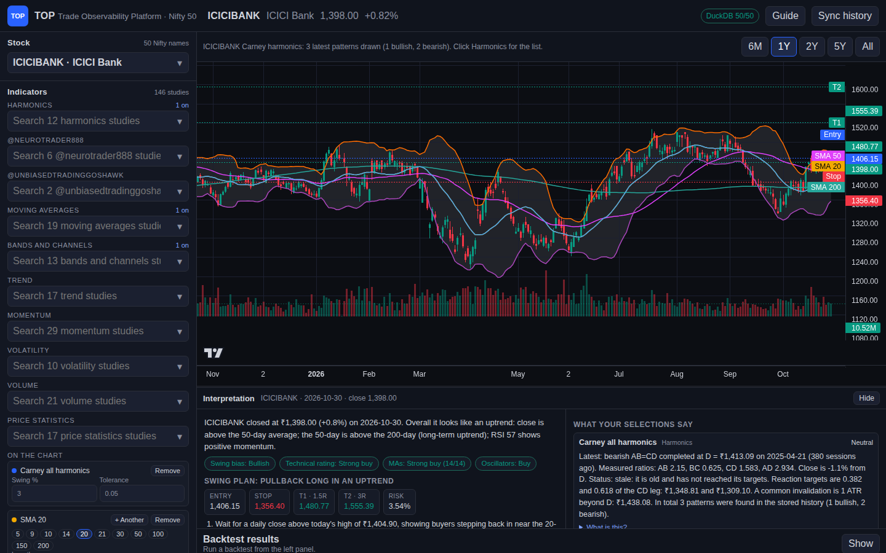
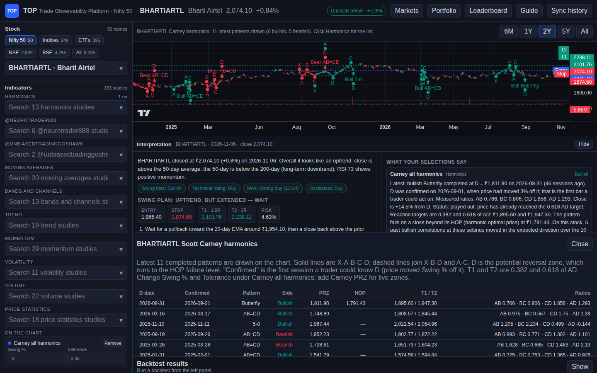
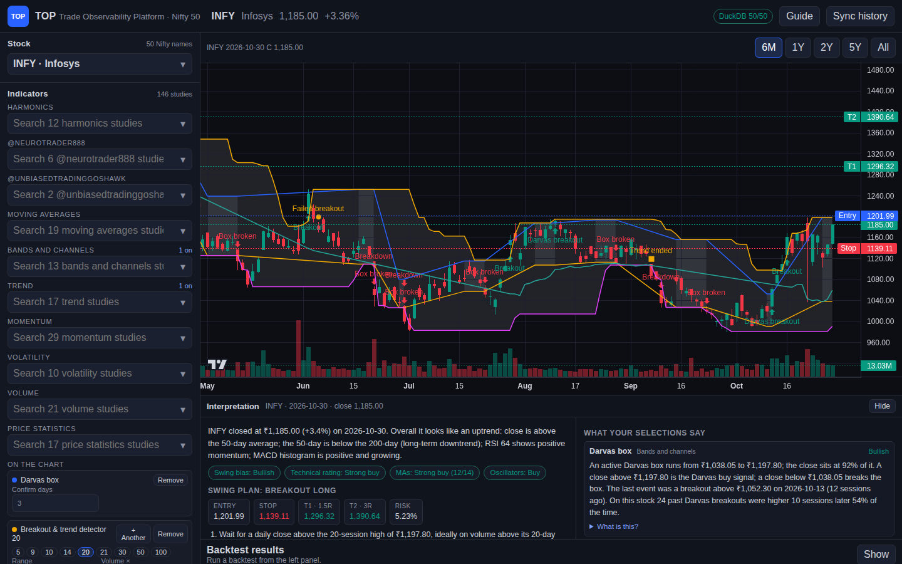
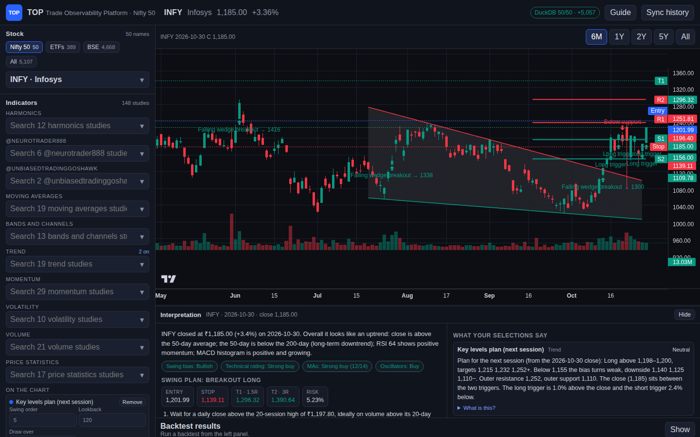
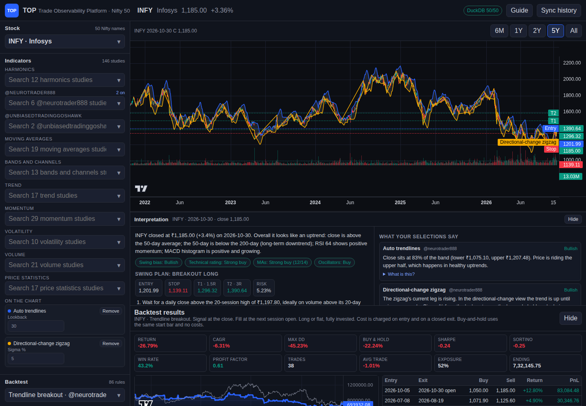
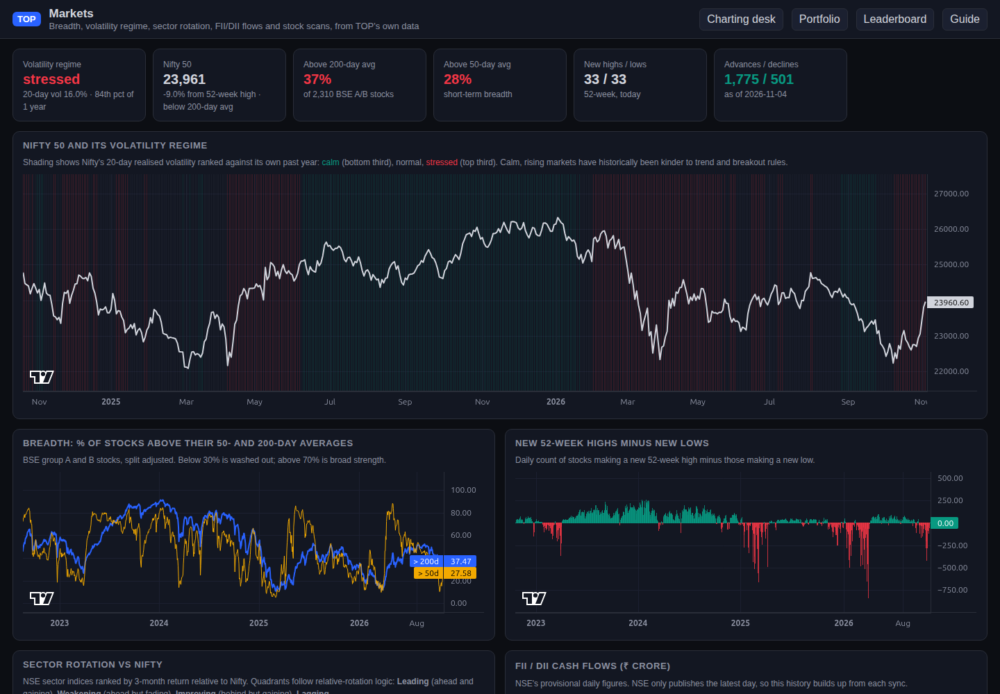
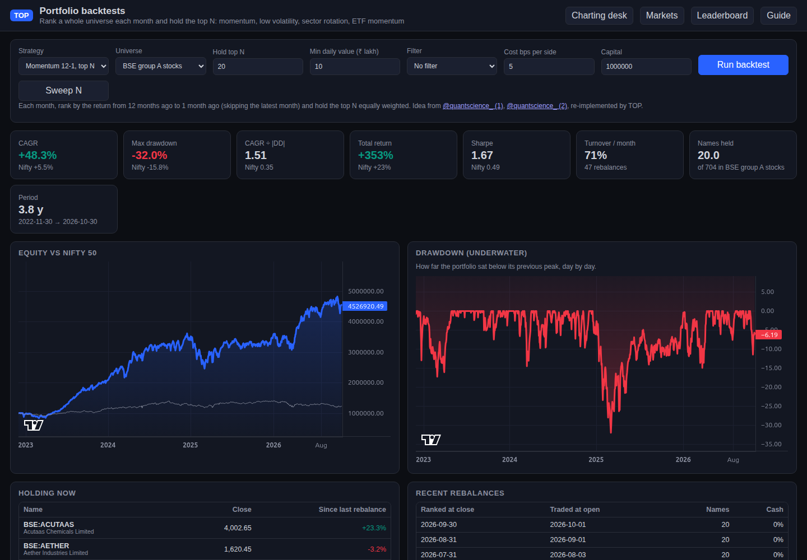
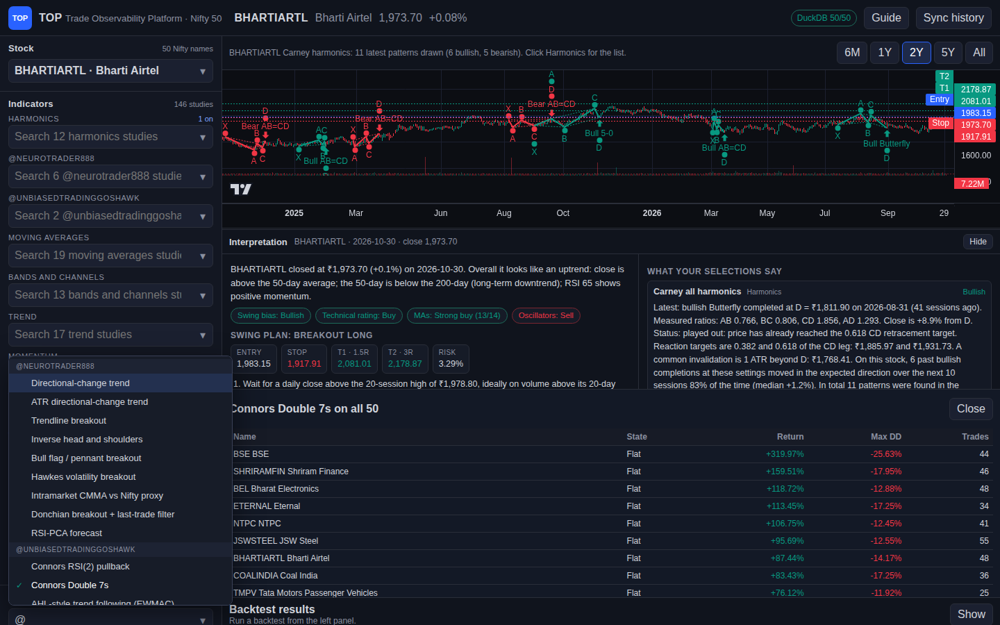

# 🧑‍💻 User guide

A walkthrough of every part of TOP. The same guide is built into the app: click **Guide** in the top bar, or open `http://127.0.0.1:8000/guide.html`.

- [The screen](#the-screen)
- [Pick a stock](#pick-a-stock)
- [Indicators and durations](#indicators-and-durations)
- [Scott Carney harmonics](#scott-carney-harmonics)
- [Darvas boxes and breakouts](#darvas-boxes-and-breakouts)
- [Interpretation and swing plan](#interpretation-and-swing-plan)
- [Backtesting](#backtesting)
- [YouTube creator strategies](#youtube-creator-strategies)
- [Analysis buttons](#analysis-buttons)
- [Shareable links](#shareable-links)
- [Keyboard and tips](#keyboard-and-tips)

---

## The screen



| Area | What it holds |
| --- | --- |
| **Top bar** | Selected stock, price and day change, `DuckDB 50/50` coverage, **Guide**, **Sync history** |
| **Left panel** | Every control, as searchable dropdowns: **Stock**, one dropdown per **indicator section**, **On the chart** (active studies and their settings), **Backtest** (strategy, settings, capital, cost), **Analysis** buttons |
| **Chart** | Candles, volume, overlays on price, oscillator panes, range buttons 6M · 1Y · 2Y · 5Y · All |
| **Interpretation** | Plain-English reading of your selections and a swing plan |
| **Output panel** | Results of Harmonics list, Trend scan, Backtest universe, Fundamentals, Verify; **Close** returns the space to the chart |
| **Backtest results** | Metrics, equity curve, and trades; collapsed until your first backtest |

Nothing is drawn over the chart; panels stack below it. In windows narrower than 720 px the left panel becomes a drawer opened with **Controls**.

---

## Pick a stock

**Universe chips** above the Stock box choose what the dropdown and **Backtest universe** cover:

| Chip | What's in it | Source |
| --- | --- | --- |
| **Nifty 50** | The 50 index stocks | Yahoo, adjusted for splits and dividends |
| **Indices** | ~170 NSE indices (Nifty 50, Nifty Bank, sectoral, thematic, strategy, India VIX) and ~80 BSE indices (Sensex, BSE 100, BSE 500, sectoral) | NSE and BSE daily index files. NSE goes back five years; BSE only publishes from April 2025 |
| **ETFs** | ~355 NSE ETFs and ~35 BSE-only ETFs | Exchange bhavcopies, split adjusted |
| **NSE** | Every NSE main-board stock (EQ, BE and BZ series): the Nifty 50 plus ~2,600 more as `NSE:` symbols. SME/Emerge stocks are not included | NSE bhavcopies, split and bonus adjusted; names are matched by ISIN, so history survives renames |
| **BSE** | ~4,700 BSE equities, grouped by BSE group (A, B, T, X, …) | BSE bhavcopies, split and bonus adjusted |
| **All** | Everything | |

The Indices, ETF, NSE, BSE, and All chips appear once you've run **Sync history** (or `top-sync --bhav`). A company listed on both exchanges appears under both, for example `NSE:IRCTC` and `BSE:IRCTC`. Symbols for these universes carry a prefix, for example `BSE:ABB`, `NSE:IRCTC`, `NSE:NIFTYBEES`, `IDX:NIFTYBANK` (NSE index), or `IDX:BSE:SENSEX` (BSE index). Index volume is the constituents' traded volume for NSE and zero for BSE, so volume studies say little on BSE indices.

1. Click the **Stock** box, or press <kbd>/</kbd> anywhere.
2. Type a symbol, a company name, or a sector, for example `infy`, `mahindra`, `pharma`, `energy`, or `financ bank`. Every word must match.
3. Use <kbd>↑</kbd> <kbd>↓</kbd> and <kbd>Enter</kbd>, or click. The list is grouped by sector, ETF type, or BSE group, and shows each stock's last price and day change. Typing searches every universe by name, symbol, or BSE code (for example `suzlon` or `500325`), whichever chip is on; exact symbol matches come first, and picking a name from another universe switches the chip. Long lists show the first 150 matches; keep typing to narrow them.

Your studies stay on when you switch stocks.

---

## Indicators and durations

There are **152 studies** in 10 searchable dropdowns: Harmonics, @neurotrader888, @UnbiasedTradingGoshawk, Moving averages, Bands and channels, Trend, Momentum, Volatility, Volume, and Price statistics. They are listed in full in the [indicator catalog](indicators.md).

- **Add or remove**: pick a study in its dropdown. The list stays open so you can add several, and ✓ marks the ones that are on.
- **Overlay or Pane**: overlays draw on price; panes open below the chart.
- **Change the period**: under **On the chart**, click a preset (5 · 9 · 10 · 14 · 20 · 21 · 30 · 50 · 100 · 150 · 200) or type any value.
- **Same average, several periods**: **+ Another** adds a copy at the next classic period (9 → 20 → 50 → 100 → 200). For example, SMA 20 + SMA 50 + SMA 200. Each copy has its own line, colour, settings, and Interpretation card.
- **Bands are shaded**: any study with upper and lower lines (Bollinger, Keltner, Donchian, envelopes, ATR bands, StdDev channel, Darvas box, breakout range, auto trendlines) is filled light grey beneath the candles.
- **EMA ribbon**: five adjustable lengths (default 8, 13, 21, 34, 55).

---

## Scott Carney harmonics



**Carney all harmonics** is on by default for every stock. It finds swings with a zigzag (Swing %, default 3) and matches each run of X-A-B-C-D pivots against Carney's ratios (Tolerance, default ±0.05).

| On the chart | Meaning |
| --- | --- |
| Solid green or red legs | X-A-B-C-D of the latest 12 patterns (green bullish, red bearish) |
| Dashed lines | X-B-D and A-C ratio guides |
| Letters | Pivot labels |
| Arrow at D | Completion: the potential reversal zone (PRZ) |

**Harmonics list** (under Analysis) shows each pattern's D date, name, side, PRZ, and measured AB/BC/CD/AD ratios. To show one pattern only, pick it from the Harmonics dropdown and remove *Carney all harmonics*.

Patterns: Gartley, Bat, Alternate Bat, Butterfly, Crab, Deep Crab, Cypher, Shark, 5-0, AB=CD, and Three Drives.

---

## Darvas boxes and breakouts



**Darvas box** (Bands and channels)
- Top: a high not exceeded for 3 sessions. Bottom: a low not undercut for 3 sessions after the top.
- The box is drawn and shaded from the day it is confirmed.
- Markers: **Darvas breakout** (close above the top) and **Box broken** (close below the bottom).

**Breakout & trend detector** (Trend)
- Shades the prior 20-session range.
- **Breakout** / **Breakdown**: a close beyond the range on at least 1.5× average volume.
- **Failed breakout**: back inside the range within 3 sessions.
- After a breakout, a trailing stop (best close − 3 ATR) follows the trend; **Trend ended** marks where it was hit.

Matching strategies: **Darvas box breakout** and **Volume breakout trend** in the Breakout group.

---

## Key levels and pattern breakouts

Two **Trend** studies follow the way the X account [@TradZoo](https://x.com/TradZoo) writes its daily chart posts. Only the method was studied; TOP computes every level itself.



**Key levels plan (next session)** draws today's four levels as flat lines across the last 30 sessions (*Draw over*): outer resistance R2 and inner resistance R1 in red, inner support S1 and outer support S2 in green. The Interpretation pane writes the plan for the next session, for example:

> Long above 1,175–1,178, targets 1,185 1,195 1,205+. Below 1,152 the bias turns weak, downside 1,135 1,118 1,098−. Outer resistance 1,204, outer support 1,099.

- **R1 and S1** are the nearest support and resistance levels just around the close. They come from clustered swing highs and lows plus the last few sessions' extremes.
- **R2 and S2** are the next levels out.
- The three targets step from the trigger to the outer level and are rounded to a sensible price step (about 0.2% of price).
- Markers show where price closed through a trigger in the last 10 sessions.

**Pattern breakout projector** fits support and resistance lines over the last 60 bars, shades the pattern grey, and names it: falling or rising wedge, ascending, descending, or symmetrical triangle, channel, range, or broadening wedge. On a daily close through resistance it writes:

> Falling wedge breakout on 2026-10-14 above 1,084. Buying zone 1,084–1,098, stop below 990, target 1 1,195, target 2 1,300 (pattern height 217 projected from the breakout). Status: in play.

It also reports how often this stock's past breakouts reached target 2.

Matching strategies in the Breakout group: **Key level breakout** and **Pattern breakout (measured move)**.

## Interpretation and swing plan

The pane under the chart refreshes whenever you change anything on the left.

**Left half: swing outlook**
- **Headline**: close, day change, and why the stock reads as an uptrend, range, or downtrend.
- **Badges**: swing bias, a technical rating (votes from 14 moving averages and 9 oscillators), and the MA and oscillator sub-ratings.
- **Swing plan**: one of *harmonic reversal*, *breakout*, *pullback in an uptrend*, *extended — wait*, *range*, or *no long setup*. It gives a trigger, entry, stop, T1 (~1.5R), T2 (~3R), position size for 1% risk of your capital, and a time stop. The levels are drawn on the chart as dashed lines.
- **Same plan on this stock's past**: how often T1 was hit before the stop, and the average R.
- **Base rate**: how often the stock was higher 10 sessions after similar conditions.

**Right half: what your selections say**: one card per study and the selected strategy, with the latest change highlighted. **What is this?** explains each tool.

> [!NOTE]
> The odds describe this stock's own history. They are not a forecast or advice.

---

## Backtesting



1. Pick a stock.
2. In **Backtest**, search a strategy (for example `gartley`, `darvas`, `breakout`, `rsi`, or `@neuro`). There are 92, listed in the [strategy catalog](strategies.md).
3. Adjust its settings, **Capital** (default ₹10,00,000), **Cost bps** (default 5), and **Sizing**:
   - **Full**: every entry uses all equity (default).
   - **Vol target**: each entry uses *Target vol %* ÷ the stock's 20-day volatility of equity, capped at 100%, so calm stocks get full size and wild ones less.
   - **Half Kelly**: each entry uses half the Kelly fraction estimated from the strategy's *earlier* trades on this stock (50% until there are 10 trades, nothing while the estimate is negative).
4. Click **Run backtest**.

| Rule | Detail |
| --- | --- |
| Positions | Long or flat; never short |
| Fills | Signal at the close, fill at the next session's open |
| Costs | Basis points on entry and on each exit |
| Benchmark | Buy and hold from the same first bar |

Results show Return, CAGR, Max DD, Buy & hold, Sharpe, Sortino, Win rate, Profit factor, Trades, Avg trade, Exposure, **Kelly** (the Kelly fraction from the trades), **Avg position**, and Ending equity, plus the equity curve and every trade.

Under the cards, **Monte Carlo** reshuffles the closed trades 1,000 times and reports the range of maximum drawdown: same trades, different order. Plan for the bad 5% case rather than the backtest's own drawdown.

**Walk-forward** (next to Run backtest) checks whether the strategy's main setting is over-tuned. For each calendar year after the first two, it picks the best of five values around your setting using only earlier data, then joins those out-of-sample years into one result and compares it with keeping your setting fixed. *Stable* means the chosen value rarely changed.

**Backtest universe** (labelled *Backtest Nifty 50*, *Backtest ETFs*, *Backtest BSE*, or *Backtest all*) runs the selected strategy on the current universe and ranks the results. For ETFs, BSE, and All, it uses the 200 most traded names over the last ~45 days, so a scan takes 1–2 minutes.

---

## Strategy leaderboard

Click **Leaderboard** in the top bar (or open `/leaderboard.html`) for a page that ranks **every strategy on every script**: all 92 strategies, with default settings, on every stock, ETF, and index with at least a year of bars, about 610,000 backtests.

1. Press **Run backtests**. The work runs in the background on all CPU cores at low priority, and the page shows progress, speed, and time left. The Nifty 50 and indices go first, then ETFs, then BSE stocks by traded value, so useful rows appear early. It takes a few hours on a slow two-core PC.
2. **Stop** at any time. **Run / resume** carries on where it stopped and, after a daily sync, recomputes only scripts with new bars. **Recompute all** starts over.
3. Rows are ranked by **CAGR ÷ |max drawdown|** (the MAR ratio), with drawdowns under 5% counted as 5% so a rule that barely moved can't top the table. By default only backtests with **CAGR above 15%**, at least 3 trades, at least **2 tested years**, and a median of at least **₹10 lakh traded a day** over the last year are shown. Tested years count only the time after the strategy's warm-up (a 200-day average needs 200 bars first), so short tests don't annualise into silly CAGRs. Indices are exempt from the traded-value floor. Change any of these, or clear Min CAGR to see everything.
4. Narrow with the universe chips (All · Nifty 50 · Indices · ETFs · BSE), a strategy, or a script search. **Sort by** offers CAGR ÷ |Max DD|, **Most return ÷ |Max DD|** (total return over the whole test ÷ worst drawdown, same 5% floor), CAGR, smallest drawdown, Sharpe, total return, win rate, or trades. Click a column header to sort by it. Tick **Best strategy per script** to keep only each script's top row by the chosen sort.
5. **Strategies that pass most often** on the right counts how many scripts each strategy passes on, with median CAGR, drawdown, and ratio. Click one to filter.
6. Click any row to open that script with that strategy backtested on the chart.
7. Switch to **By strategy** to rank the strategies themselves. Each is scored by the **median of total return ÷ |max drawdown|** across every script that passes the trade, tested-years, and traded-value filters. There is no CAGR cut, so losers count, and strategies need at least 50 scripts. Columns show the mean, the middle half, median return, drawdown and CAGR, % profitable, % beating buy-and-hold, median trades, and the best script. **Rank strategies by** re-sorts. Click a strategy to see its scripts. **Download CSV** saves the ranking.

To rebuild the committed snapshots in `results/` on any machine: stop the server, then `top-sync` and `top-leaderboard --results results`. **Download CSV** saves every row that matches the filters, in rank order.

Scripts with unreliable data are skipped rather than ranked: those that traded on fewer than half the weekdays in their history, and those with a one-day move above +100% or below −50% after split adjustment (usually a bad tick or an unadjusted corporate action on a thin BSE listing). Index series that are not prices (Nifty50 Dividend Points, India VIX) are left out too. The run status shows how many were skipped.

Each backtest uses ₹10 lakh, 5 bps per side, long/flat, filling at the next open, over all stored history. With so many strategies and scripts some winners are luck: prefer strategies that pass on many scripts, with plenty of trades and full five-year history. From the command line, with the server stopped, `top-leaderboard` runs the same job.

---

## Markets page

Click **Markets** in the top bar for a market-wide view built from TOP's own data. Its ideas come from the [X research digest](research/x-digest.md).



| Section | What it shows |
| --- | --- |
| Cards | Nifty's volatility regime, distance from its 52-week high and 200-day average, % of stocks above their 50- and 200-day averages, new highs vs lows, advances vs declines |
| **Volatility regime chart** | Nifty with its regime shaded: Nifty's 20-day realised volatility ranked against its own past year as *calm* (bottom third), *normal*, or *stressed* (top third) |
| **Breadth** | % of BSE group A and B stocks above their 50- and 200-day averages, and daily new 52-week highs minus new lows. Prices are split adjusted, so a split never counts as a new low |
| **Sector rotation** | NSE sector indices ranked by 3-month return relative to Nifty, with 1- and 6-month figures and a quadrant: Leading, Weakening, Improving, or Lagging |
| **FII / DII** | NSE's provisional daily cash figures in ₹ crore. NSE publishes only the latest day, so the history starts from your first sync |
| **Scans** | Bloodbath (30–60% below the 52-week high, still 10% above the low), Multi-year breakout, 52-week breakout on volume, Breakout soon, Leaders while Nifty falls, 1-year multibaggers near highs, Near 52-week low, and Delivery surge. Set the minimum daily traded value; click a stock to chart it |

On the desk, the **Market volatility regime (Nifty)** study (Volatility section) draws the same regime under any chart, and **Delivery %** (Volume section) shows NSE delivery % with its 20-day average.

---

## Portfolio page

Click **Portfolio** for backtests that rank a whole universe each month and hold the top *N*, instead of trading one stock.



| Strategy | Default universe | Rule |
| --- | --- | --- |
| **Momentum 12-1** | BSE group A | Return from 12 months ago to 1 month ago; hold the top 20 |
| **Low volatility** | BSE group A | Lowest 1-year volatility of daily returns; hold the top 20 |
| **Sector rotation** | NSE sector indices | Best 6-month return; hold the top 3 |
| **ETF momentum with trend filter** | NSE ETFs | Best 12-month return among ETFs above their 10-month average; hold up to 3, rest in cash |

Universes: Nifty 50, BSE group A, NSE sector indices, or NSE ETFs. **Filter** adds absolute momentum (only positive scores) or a market filter (cash while Nifty is below its 200-day average). Names below the **Min daily value** are skipped.

Ranking happens at each month-end close using only data to that close; trades happen at the next open, to equal weights, with costs on every rupee traded. The page shows CAGR, drawdown, CAGR ÷ DD, Sharpe and turnover against Nifty 50, the equity curve, an underwater (drawdown) chart, current holdings, and recent rebalances. **Sweep N** reruns the strategy for N = 1, 3, 5, 10, 20, 30 and 50, because the number of names changes results the most.

> [!WARNING]
> The universe is today's listing, so stocks that were delisted in the last five years are missing. That survivorship bias flatters these results, especially for small caps.

---

## YouTube creator strategies



| Group | Strategies | Indicators |
| --- | --- | --- |
| **@neurotrader888** | Directional-change trend, ATR zigzag, trendline breakout, inverse head and shoulders, bull flag/pennant, Hawkes volatility breakout, CMMA vs Nifty proxy, Donchian + last-trade filter, RSI-PCA forecast | Zigzag, auto trendlines, Hawkes volatility, VSA, CMMA, permutation entropy |
| **@UnbiasedTradingGoshawk** | Connors RSI(2), Connors Double 7s, AHL-style EWMAC trend, Lo–Khandani contrarian | EWMAC forecast, return vs Nifty proxy |

Picking one shows its creator, a confidence label (HIGH = from the creator's own code; MEDIUM = from the original public source), source links, and how it was adapted. Details and first results are in [creators.md](creators.md).

---

## Analysis buttons

| Button | What it does |
| --- | --- |
| **Harmonics list** | Lists the drawn Carney patterns with ratios |
| **Trend scan** | Runs every Trend, Breakout, and Trend reversal rule on the selected stock; rules that are long now are listed first |
| **Fundamentals** | Screener.in ratios (market cap, P/E, ROCE, ROE, …) and pros/cons, cached for 6 hours. BSE stocks are looked up by scrip code; ETFs have no fundamentals |
| **Verify** | Runs every browser and server self-check and lists Pass/Fail |

---

## Shareable links

Any set-up can be opened from a URL, which is handy for bookmarks and sharing:

| Parameter | Example | Meaning |
| --- | --- | --- |
| `symbol` | `symbol=INFY`, `symbol=BSE:ABB`, `symbol=NSE:NIFTYBEES` | Stock or ETF to open |
| `universe` | `universe=bse` | `nifty50`, `etf`, `bse`, or `all` |
| `studies` | `studies=sma:20,sma:50,sma:200,bbands` | Studies to add; `id:period` sets the period |
| `carney` | `carney=0` | Turn off the default harmonics |
| `strategy` | `strategy=darvas_breakout` | Pre-select a strategy |
| `range` | `range=252` | 126 (6M), 252 (1Y), 504 (2Y), 1260 (5Y), or `all` |
| `run` | `run=backtest` | Also `trend`, `scan`, `harmonics`, `fundamentals`, `verify` |
| `menu` + `q` | `menu=stock&q=bank` | Open a dropdown with a search |

Examples:

```text
http://127.0.0.1:8000/?symbol=ICICIBANK&studies=sma:20,sma:50,sma:200,bbands&range=252
http://127.0.0.1:8000/?symbol=INFY&carney=0&studies=darvas,breakout_trend&range=126
http://127.0.0.1:8000/?symbol=TCS&strategy=ut_ahl_trend&run=backtest
http://127.0.0.1:8000/?strategy=harm_gartley&run=scan
```

Study and strategy IDs are listed in the [indicator](indicators.md) and [strategy](strategies.md) catalogs.

---

## Keyboard and tips

| Key | Action |
| --- | --- |
| <kbd>/</kbd> | Jump to the Stock search |
| <kbd>↑</kbd> <kbd>↓</kbd> <kbd>Enter</kbd> | Move and pick in any dropdown |
| <kbd>Esc</kbd> | Close a dropdown |
| <kbd>Ctrl</kbd>+<kbd>Shift</kbd>+<kbd>R</kbd> | Hard-reload after an update |

- **Hide** on the Interpretation pane or Backtest results gives the chart more room.
- If the chart looks busy, remove *Carney all harmonics* or pick a single pattern.
- Refresh data after market close with **Sync history** or `top-sync`.
